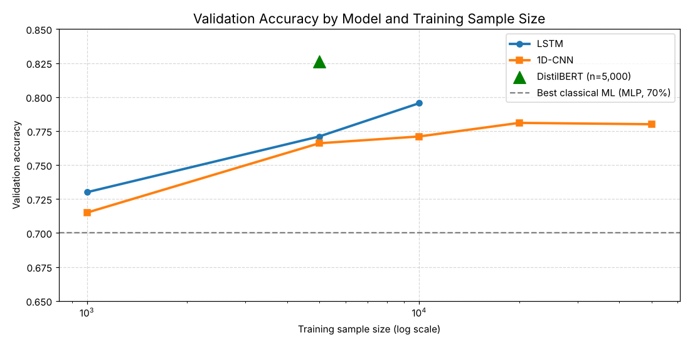
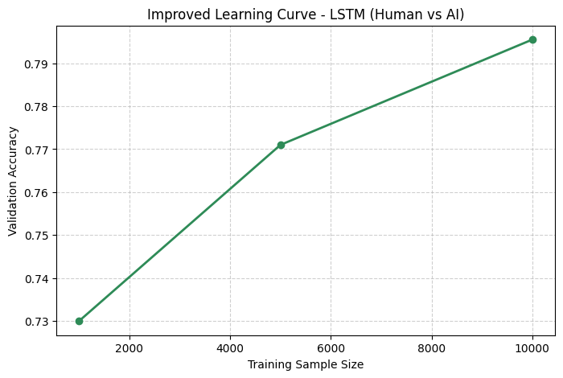
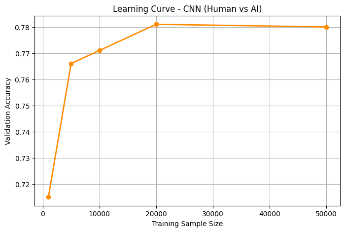
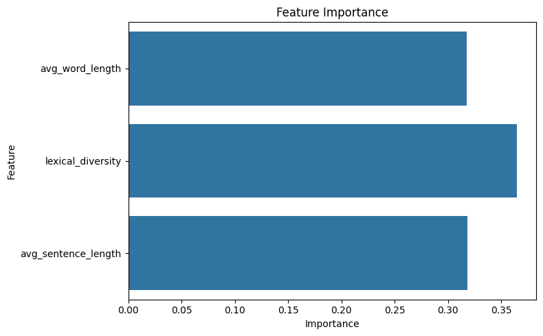
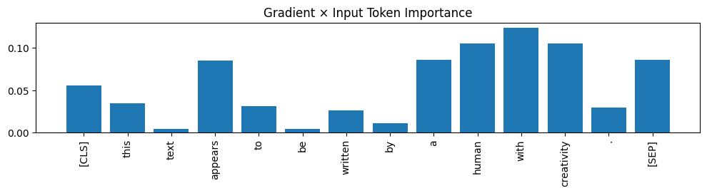

# Human vs. LLM Text Detection

**Can a model tell whether a piece of text was written by a person or generated by a large language model?**

This is my M.S. Data Science capstone project at Montclair State University. It compares classical machine learning on stylometric features, deep learning (LSTM and 1D-CNN), and a fine-tuned transformer (DistilBERT). It also explains what the models rely on and where they fail.

**Best result: fine-tuned DistilBERT reached 82.6% validation accuracy (F1 0.80), 12.6 points above the best classical model.**



---

## Highlights

- Built a **balanced 10,000-text dataset** (5,000 human, 5,000 LLM) from a 788,922-record Kaggle corpus spanning **62 LLM sources** (GPT-3.5, GPT-4, LLaMA, Mistral, Gemini and more)
- Engineered **stylometric features** with spaCy and benchmarked **6 classical ML models**
- Trained **LSTM and 1D-CNN** models in TensorFlow/Keras and plotted learning curves across sample sizes
- Fine-tuned **DistilBERT** in PyTorch with mixed-precision GPU training
- Explained predictions with **attention maps, gradient × input saliency, and occlusion tests**
- Ran **error analysis** on misclassified texts by readability, sentiment, pronoun use and grammar

## Dataset

[Human vs. LLM Text Corpus](https://www.kaggle.com/datasets/starblasters8/human-vs-llm-text-corpus) on Kaggle (MIT license): 788,922 texts, of which 347,692 are human-written and the rest come from 62 different language models.

A balanced random sample of 5,000 human and 5,000 LLM texts (`random_state=42`) was used for modelling. The LLM half keeps the corpus's mix of models, so the classifier has to generalise across many generators instead of learning a single model's style.

## Approach

### 1. Stylometric features + classical ML
spaCy was used to extract three features per text: **average word length, lexical diversity (unique / total words) and average sentence length**. Six models were trained on an 80/20 train/test split.

### 2. Deep learning on raw text
Texts were tokenised (10,000-word vocabulary, sequence length 150) and used to train:
- **LSTM** with embedding, dropout, early stopping and learning-rate scheduling
- **1D-CNN** with global max pooling

Both were trained on increasing sample sizes to produce learning curves.

### 3. Transformer fine-tuning
`distilbert-base-uncased` was fine-tuned with Hugging Face Transformers in PyTorch: AdamW, linear warm-up schedule, mixed-precision (AMP) training on a GPU, max length 256 tokens, and a stratified 90/10 split of a 5,000-text sample.

### 4. Explainability and error analysis
- **Attention maps** show which tokens DistilBERT attends to
- **Gradient × input saliency** shows which tokens push the prediction most
- **Occlusion tests** mask one token at a time and measure the change in probability
- Misclassified texts were analysed by **Flesch readability, sentiment polarity, pronoun count, lexical diversity, non-standard grammar and heuristic failure reasons**

## Results

| Model | Input | Accuracy | F1 (macro) |
|---|---|---|---|
| Naive Bayes | Stylometric features | 56% | 0.56 |
| Logistic Regression | Stylometric features | 63% | 0.63 |
| Linear SVM | Stylometric features | 63% | 0.63 |
| XGBoost | Stylometric features | 68% | 0.68 |
| Random Forest | Stylometric features | 69% | 0.69 |
| MLP | Stylometric features | 70% | 0.70 |
| 1D-CNN | Raw text (10k sample) | 77.1% | – |
| LSTM | Raw text (10k sample) | 79.6% | – |
| **DistilBERT (fine-tuned)** | **Raw text (5k sample)** | **82.6%** | **0.80*** |

\*Binary F1 for the positive class. Deep learning figures are validation accuracy.

**Learning curves:** the 1D-CNN levelled off at about 78% beyond 20,000 samples. The LSTM was still improving at 10,000.

<p float="left">
  
  
</p>

## Key findings

- **Simple style features are not enough.** Word length, sentence length and lexical diversity separate human and LLM text only about 70% of the time, because modern LLMs closely imitate human style statistics.
- **Context matters.** Models that read the full sequence did much better, and the pretrained transformer did best even with half the data.
- **No single style feature dominates.** In the Random Forest, lexical diversity was slightly more important than average word length and sentence length, but all three contributed about equally.
- **Misclassified texts look alike on the surface.** Among the texts the model got wrong, readability and sentiment distributions are almost identical for human and LLM writing; human texts show only slightly higher lexical diversity.

<p float="left">
  
  
</p>

## Limitations

- DistilBERT was fine-tuned on a 5,000-text sample because of GPU limits. Larger samples would likely improve it.
- The "human annotator" comparison in the notebook uses **simulated** judgments (labels flipped at random 20% of the time), so it is exploratory and not a real human study.
- Results come from one random split. Cross-validation would give more reliable estimates.
- The corpus contains older and newer LLMs, so accuracy on the very latest models may differ.

## Tech stack

Python · pandas · NumPy · spaCy · scikit-learn · XGBoost · TensorFlow/Keras · PyTorch · Hugging Face Transformers · textstat · TextBlob · Matplotlib · Seaborn · Google Colab (GPU)

## Repository structure

```
├── Human_vs_LLM_Text_Detection.ipynb   # full analysis notebook
├── *.png                               # charts used in this README
├── requirements.txt
└── README.md
```

## How to run

1. Open the notebook in [Google Colab](https://colab.research.google.com/) and select a GPU runtime (Runtime → Change runtime type).
2. Create a Kaggle API token (Kaggle → Settings → Create New Token) and upload `kaggle.json` to Colab when prompted. **Never commit this file.**
3. Run the cells in order. The first cells download the dataset and build the balanced sample.

To run locally instead:

```bash
pip install -r requirements.txt
python -m spacy download en_core_web_sm
jupyter notebook Human_vs_LLM_Text_Detection.ipynb
```

The notebook was written for Colab, so update the file paths (`/content/...`) if you run it locally.

## Author

**Shabbir Kagalwala** · M.S. Data Science, Montclair State University
[LinkedIn](https://www.linkedin.com/in/shabbir-kagalwala-b24279223) · [GitHub](https://github.com/Shabbir12-cpu) · shabbirk2002@gmail.com
